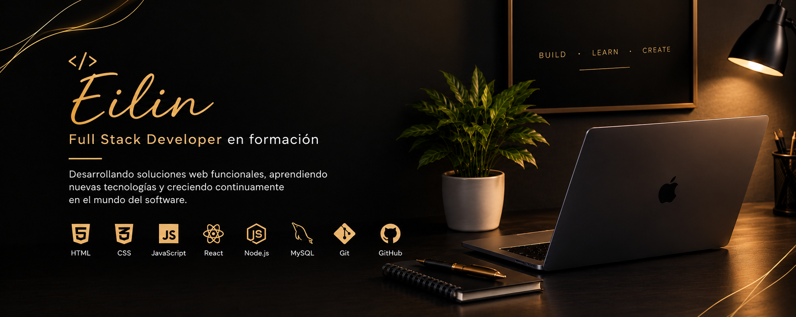

<div align="center">



<br>

# 👋 Hola, soy Eilin Acuña

### 💻 Full Stack Developer en formación

Construyendo aplicaciones web, transformando ideas en soluciones funcionales
y creciendo continuamente en el mundo del desarrollo de software.

<br>

[](https://github.com/eilinsolano0123-collab)

</div>

---

## 👩‍💻 Sobre mí

Soy **Full Stack Developer en formación**, enfocada en el desarrollo web y
en la creación de aplicaciones funcionales, atractivas y fáciles de utilizar.

Actualmente estoy fortaleciendo mis conocimientos en **frontend, backend y
bases de datos** mediante proyectos prácticos.

Me interesa seguir aprendiendo nuevas tecnologías, mejorar mis habilidades
y convertir ideas en soluciones de software.

### 💡 En qué estoy trabajando

- 💻 Desarrollo de aplicaciones web
- ⚛️ React y JavaScript
- 🟢 Node.js y Express
- 🗄️ MySQL y gestión de bases de datos
- 🎨 Diseño y desarrollo de interfaces
- 🔌 Integración de APIs
- 📚 Aprendizaje mediante proyectos prácticos
- 🚀 Mejora continua de mis habilidades

---

## 🛠️ Tecnologías y herramientas

### 🎨 Frontend


### ⚙️ Backend


### 🗄️ Bases de datos


### 🔧 Herramientas


---

## 🚀 Proyectos destacados

### 🎬 Cinemax

Aplicación web orientada a la gestión y consulta de contenido
cinematográfico.

El proyecto integra diferentes tecnologías para construir una aplicación
funcional y preparada para su despliegue.

**Tecnologías utilizadas:**

`HTML` · `CSS` · `JavaScript` · `Node.js` · `MySQL`

---

### 🏥 Laboratorio Clínico

Proyecto web desarrollado para presentar y organizar información
relacionada con un laboratorio clínico.

**Tecnologías utilizadas:**

`HTML` · `CSS` · `JavaScript`

---

### 📊 Sistema de Encuestas

Aplicación web orientada a la creación y gestión de encuestas.

**Tecnologías utilizadas:**

`HTML` · `CSS` · `JavaScript`

---

### 📋 Concesionario

Proyecto web relacionado con la gestión de información de un
concesionario.

**Tecnologías utilizadas:**

`HTML` · `CSS` · `JavaScript`

---

### 📝 Formularios Web

Proyecto práctico enfocado en la creación y manejo de formularios
interactivos.

**Tecnologías utilizadas:**

`HTML` · `CSS` · `JavaScript`

---

## 📚 Actualmente aprendiendo

- ⚛️ React
- 🟨 JavaScript
- 🟢 Node.js
- 🔌 APIs
- 🗄️ Bases de datos
- 🎨 Diseño y desarrollo de interfaces
- 🔧 Buenas prácticas de programación
- 🌱 Desarrollo Full Stack
- 📦 Gestión de proyectos con Git y GitHub

---

## 🎯 Objetivo profesional

Mi objetivo es seguir creciendo como **desarrolladora Full Stack**, construir
proyectos cada vez más completos y desarrollar soluciones de software
funcionales, mantenibles y útiles.

Busco fortalecer constantemente mis conocimientos y adquirir experiencia
mediante proyectos reales y prácticos.

---

## 📈 Mi forma de trabajar

```text
💡 Idea
   ↓
📝 Planificación
   ↓
🎨 Diseño
   ↓
💻 Desarrollo
   ↓
🧪 Pruebas
   ↓
🔧 Mejoras
   ↓
🚀 Proyecto terminado
